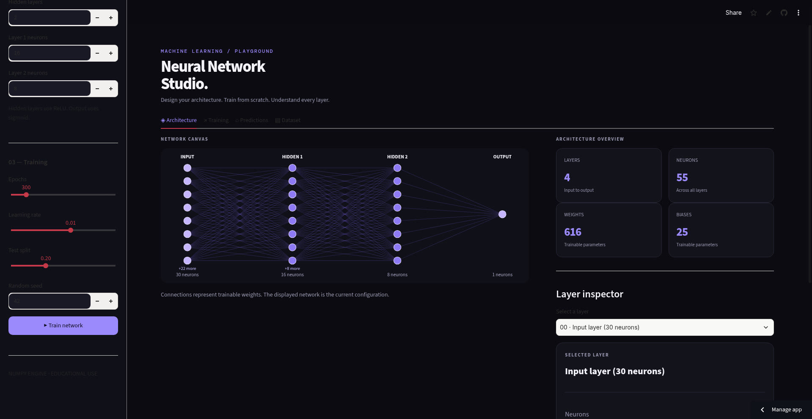
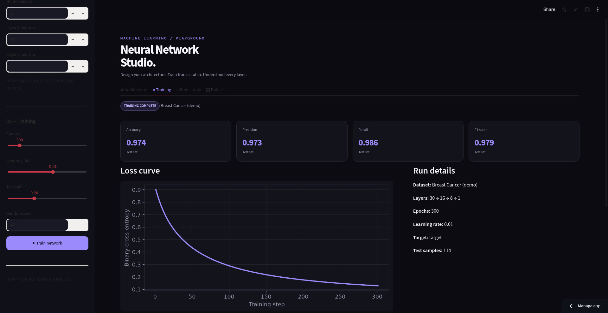

# Neural Network from Scratch

A feedforward neural network implemented from scratch using Python and NumPy, without TensorFlow or PyTorch. This educational project demonstrates neural network fundamentals and binary classification on both a logical dataset and a real-world dataset.

**Live demo:** [Neural Network Studio](https://neuralnetwork-l4tpqwmfgvw2sgamrfhmu9.streamlit.app/) - an interactive Streamlit app for configuring, training and inspecting the network in the browser.

## Neural Network Studio (web app)

`app.py` is a complete interactive playground built with Streamlit:

- **Built-in datasets:** OR Logic, XOR Logic, and scikit-learn's breast cancer dataset, or upload your own CSV.
- **Configurable architecture:** choose the number of hidden layers and neurons per layer; hidden layers use ReLU, the output layer uses sigmoid.
- **Training controls:** epochs, learning rate, test-split fraction and random seed, with a live progress indicator.
- **Results:** accuracy, precision, recall and F1 on the held-out test set, a confusion matrix, and the training-loss curve.
- **Inspection tools:** a network architecture diagram, a layer inspector (neurons, activation, weight and bias counts), a prediction explorer for individual test samples, and a dataset preview with CSV export.

### Architecture view



### Training results on the breast cancer dataset



The run shown above uses the app's configuration (30-16-8-1 layers, 300 epochs, learning rate 0.01) and reached F1 0.979 on 114 held-out samples. Results vary with the chosen architecture and hyperparameters; the command-line script `train_real_dataset.py` (below) reports its own recorded metrics.

Run it locally:

```powershell
python -m pip install -r requirements.txt
streamlit run app.py
```

## Features

- **Activation functions:** Sigmoid, ReLU, and their derivatives.
- **Dense layers:** Weight and bias initialization, forward propagation, and backpropagation.
- **Loss function:** Binary cross-entropy.
- **Training:** Gradient descent with epoch-by-epoch loss history.
- **Prediction:** Probability estimates and binary class predictions with a configurable threshold.
- **Evaluation:** Accuracy, precision, recall, F1 score, and confusion-matrix counts.
- **Visualization:** Training-loss graphs using Matplotlib.
- **Real dataset:** Training and evaluation using scikit-learn's breast cancer dataset.
- **Web app:** Interactive Streamlit interface (see above).
- **Tests:** Individual test scripts for the main components.

## Technologies

- Python
- NumPy
- Matplotlib
- scikit-learn
- Streamlit
- pytest

## Project Structure

```text
NeuralNetwork/
├── app.py                    # Streamlit web app (Neural Network Studio)
├── activations.py
├── layers.py
├── losses.py
├── model.py
├── predictor.py
├── evaluation.py
├── visualization.py
├── demo_training_plot.py
├── train_real_dataset.py
├── test_activations.py
├── test_layers.py
├── test_losses.py
├── test_training.py
├── test_evaluation.py
├── test_visualization.py
├── test_training_history.py
├── test_predictor.py
├── screenshots/              # App screenshots used in this README
├── requirements.txt
├── README.md
└── .gitignore
```

## Installation

Clone the repository:

```bash
git clone https://github.com/laya-khathoon/NeuralNetwork.git
cd NeuralNetwork
```

Create and activate a virtual environment on Windows PowerShell:

```powershell
python -m venv .venv
.\.venv\Scripts\Activate.ps1
```

Install dependencies:

```powershell
python -m pip install -r requirements.txt
```

## Run the Project

### 1. Train on the OR logic dataset

```powershell
python test_training.py
```

The script demonstrates learning the OR function using four binary input combinations.

### 2. Train on a real dataset

```powershell
python train_real_dataset.py
```

This script loads the breast cancer dataset from scikit-learn, splits it into training and test sets, standardizes the features, trains the neural network, reports classification metrics, and saves a training-loss graph as `real_dataset_training_loss.png`.

The dataset contains 569 samples and 30 features. The experiment is for educational purposes and is not intended for clinical diagnosis.

Latest recorded run: accuracy 0.965, precision 0.972, recall 0.972, F1 score 0.972 on the held-out test split (70 true positives, 40 true negatives, 2 false positives, 2 false negatives).

### 3. Generate a training-loss plot

```powershell
python demo_training_plot.py
```

The graph is saved as `training_loss.png`.

### 4. Launch the web app

```powershell
streamlit run app.py
```

## Prediction API

Use the `predict` function from `predictor.py` with a trained network and inputs that have the same feature order and preprocessing used during training:

```python
from predictor import predict

# network must already be trained.
# X must contain preprocessed input features.
probabilities, predicted_classes = predict(
    network,
    X,
    threshold=0.5
)

print(probabilities)
print(predicted_classes)
```

The function returns probabilities and binary predictions. A probability greater than or equal to the threshold is classified as class 1; otherwise, it is classified as class 0.

## Evaluation Metrics

The `evaluation.py` module calculates:

- Accuracy
- Precision
- Recall
- F1 score
- True positives, true negatives, false positives, and false negatives

The meaning of the positive class depends on how the dataset encodes its target labels.

## Testing

Run individual test scripts:

```powershell
python test_activations.py
python test_layers.py
python test_losses.py
python test_training.py
python test_evaluation.py
python test_visualization.py
python test_training_history.py
```

Test the prediction module with pytest:

```powershell
python -m pytest test_predictor.py -v
```

## Example OR Dataset

| Input | Expected output |
|---|---:|
| `[0, 0]` | 0 |
| `[0, 1]` | 1 |
| `[1, 0]` | 1 |
| `[1, 1]` | 1 |

In the recorded training run, the loss decreased from approximately 0.992725 to 0.004776, and all four inputs were classified correctly at a threshold of 0.5.

## Learning Objectives

- Understand forward propagation and backpropagation.
- Implement activation and loss functions.
- Learn how gradients update model parameters.
- Track training loss and evaluate predictions.
- Apply a from-scratch model to a real dataset.

## Future Improvements

- Add multiclass classification.
